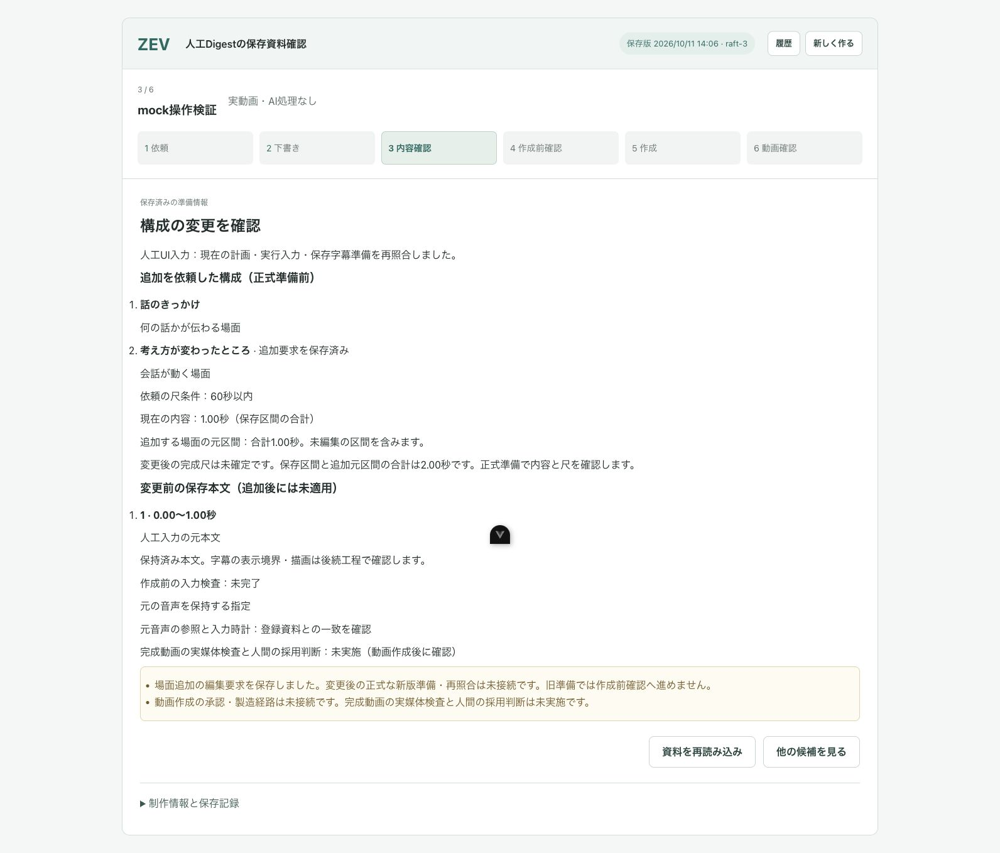

# Codex-UI｜No.68 保存シーンを構成へ追加する編集要求

2026-10-11。親の技術判断「全体の採用集合へ一場面を明示追加。他の採用場面を保持。人間の編集要求を独立保存し、正式な新版準備まで作成前確認へ進めない」に従った限定実装。No.68全体は未完成、No.70は未着手。

## 変更結果

保存候補を見ているだけでは、採用中の構成は変わらない。未採用の場面で **「この場面を構成に追加」→追加内容・尺の影響を確認→「追加要求を保存」** と操作すると、人間の編集要求だけを保存する。現在の採用場面を残し、追加した場面を含む全体構成を元の順番で表示する。採用中・追加要求済み・元区間が重複する場面は、それぞれ理由を示して重複追加や暗黙の差替えを防ぐ。

保存後は内容確認へ戻り、「追加を依頼した構成（正式準備前）」と表示する。変更前の保存本文は追加後に適用済みとして扱わない。現在の保持区間の合計と追加する未編集の元区間を示し、完成尺は正式準備まで未確定と書く。資料を再読み込みしたりアプリを再表示したりしても、保存済み要求と作成停止の理由を保持する。

保存でAI処理・動画作成・費用の承認は行わない。正式な新版準備が未接続であることを明示し、旧資料で作成前確認へ進めない。人間の好み・品質採用や正式な製造の合格は未確認である。

## 実装と境界

- client：候補の閲覧、追加確認、取消、明示保存を分離。保存中の連続クリックを抑止し、別依頼・別版へ移った後の遅い応答を適用しない。候補ダイアログを閉じると未保存の確認を消す。
- backend consumer：既存の人間認証と操作キュー内で、現在の依頼全文、候補集合、採否集合、字幕準備、制作参照のSHAを正式readerで再照合。表示fingerprintを要求し、追加前後の全体候補IDと参照を独立した `ui-digest-edit-requests.json` に追記保存する。同一保存の再送は同じ記録を返す。
- production：AI採否JSON・旧plan・producer/output/FileRef・state・人間品質/製造許可を上書きしない。新たな正式producer/製造契約・runner操作は追加していない。元順・非重複・元本文/時計/音声参照を維持する。資料が変われば以前の編集要求を自動消化せず対応確認待ちとする。

変更sourceは13file。既存sharedのUI専用型を拡張したが、正式なmachine contract、shared entrypointの実装SHA、制作担当の `evals/clip_composition/serve_digest_review_v001.py`、対応テスト、runner、中央Goal/HANDOVER/DECISIONSを変更していない。[現物SHA・禁止範囲の差分なし・検証要約](scene-addition-evidence/verification-v001.json)。素材固有の値や後方互換分岐は追加していない。

## 検証

| 検証 | 結果・意味 |
| --- | --- |
| backend unit | 22/22、失敗0、exit0。新しい編集要求8件と既存資料照合6件・受渡し8件。人工A/Bで既存正式readerを使用し、閲覧無作用、同時再送、採用済みno-op、認証/余分な権限項目/古い版の拒否、資料改変、旧要求の自動消化拒否、重複区間、別backend processでの再読を確認 |
| client unit | 24/24、失敗0、exit0。新追加4件で1回保存、保存中重複、古い選択/別依頼/未登録/既採用の拒否、遅い応答、追加状態と内容確認への戻りを確認 |
| type/build | backend build（shared/runner含む）とclient build（vue-tsc/shared含む）exit0。Appのフォーカス修正後client buildを再実行しexit0。既存のchunk-size警告あり |
| UI契約検査 | 成功。人間の製造承認境界を維持 |
| 専用Edge実操作 | 人工mockで閲覧→確認→取消→Escape、閉じる/再表示、追加保存のdouble-click、再読/reload、追加済みdisable、新規依頼へ戻る/作業へ戻る、履歴を確認。POSTは編集要求1件だけ、approve/resume/claim/complete/製造0。捕捉したbrowser error0 |

Edge検証では、追加確認を開いた後と取消後にフォーカスがbodyへ逃げてEscapeが効かない実装欠陥を発見した。確認表示の切替後、既存候補ダイアログへフォーカスを戻す限定修正を実施し、取消→Escapeで閉じて元のbuttonへ戻ることを確認した。このcycleの限定実装修正1件、既知累積2件。設営修正は追加0、以前の例外適用済み累積8件/一般枠5件を維持する。

SSD試験の最初の実行はsandboxの `mkdtemp EPERM` でテスト開始前に失敗した。同じcommandを承認済みSSD範囲への権限付きで再実行し22/22になった。helper/fixture値/検査を直した回数には数えず、[失敗log](scene-addition-evidence/backend-unit-v001.txt)と[成功log](scene-addition-evidence/backend-unit-v002.txt)を両方保持した。過去の証拠収集失敗も上書きしない。

build/unit/契約のraw log8件、[変更要求の実送信記録](scene-addition-evidence/browser-mutations-v001.json)、[確認画面](scene-addition-evidence/confirmation-v001.jpg)、[保存後のAX](scene-addition-evidence/requested-composition-v001.ax.txt)を保存・再読した。Edge mockは画面動作の証拠であり、正式準備合格の証拠ではない。実素材の製造/媒体検査/人間の採用は行っていない。費用US$0、新有料API送信0、実素材取得/STT/動画製造0、外部公開0。

## cleanupと残件

人工SSD fixture/sourceは各testの所有rootだけをcleanupし、`zev-ui68-json-test-*` と `runtime/ui68-artificial-source-*` の残件0を確認。回収容量は測定していない。mock server session22285はSIGINT/exit130、port5179にlistenerなし。自分専用Edgeタブを閉じた。他担当のアプリ/配信/processは止めていない。

監査log8件をSHA一致確認で正本へ保存後、自分の `/tmp` log23,935bytesと終了済み証拠helper5,565bytesを削除し、合計29,500bytes回収。大容量媒体を今回生成していない。元PDF・元素材・正式成果・他担当/退避領域を保持した。測定時の空きはMac 17,264,612KiB、SSD 1,903,314,432KiB。開始時の空きを測っていないため増分は主張しない。

**残る制作側の境界：** 正式producerがこの人間の編集要求を明示入力として受け取り、変更後の全採用集合・保持判断・時計・字幕準備を新版へ束縛する接続が未実装。その新版がどの編集要求を満たすかも正式な対応記録が必要。候補IDがたまたま一致しただけで、今回の要求を自動的に実施済みとする処理は入れていない。製造承認・動画作成・完成媒体/人間品質確認の通常接続も未完成。このconsumer側の保存/停止表示を完了とし、No.68全体をDoneにしない。No.70を開始しない。

Gitは親から返却されたUI leaseで、自分の必要34fileだけを明示stageしmainへcheckpoint `632e81eecd09d9305ba75b8b50dae89e2849647b` をcommit/push成功。source/Markdown/JSONの差分check成功。raw stdout/AXの原空白は保持した。後続文書保存を含む最終SHA/status/untracked/pushと次状態は[session work log](../../work-logs/2026-10/2026-10-11T0516_Codex-UI_No68-scene-addition_632e81ee.md)・親への報告で固定する。
